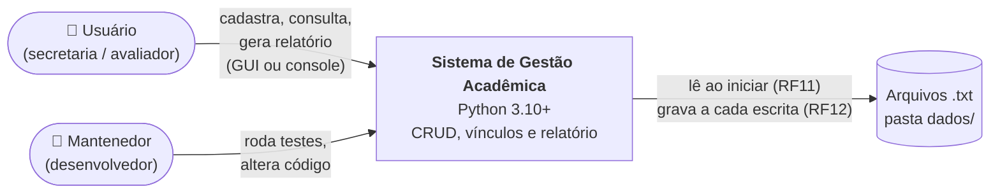
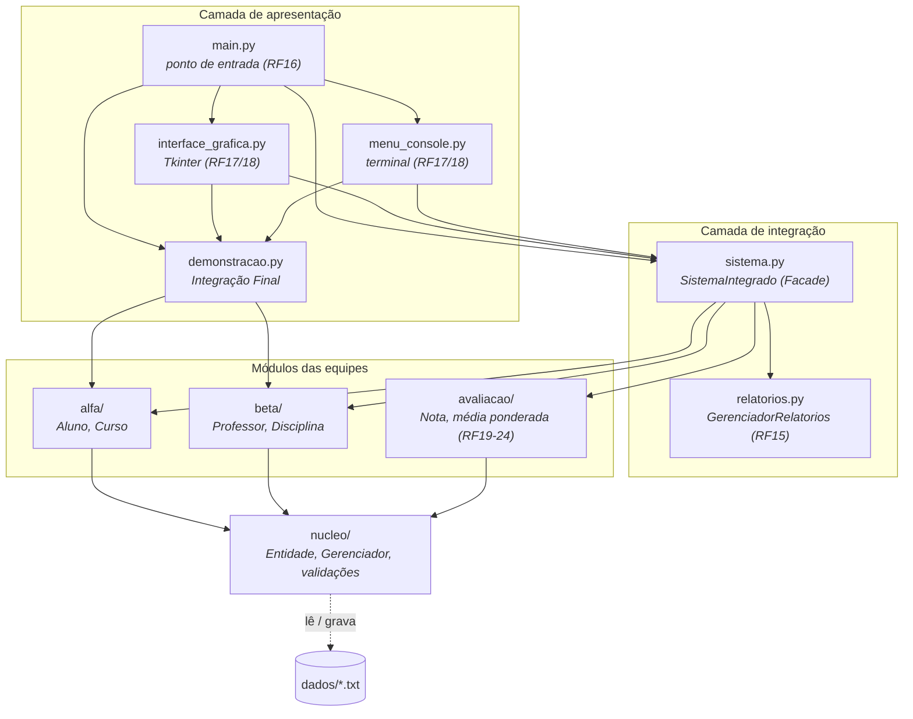
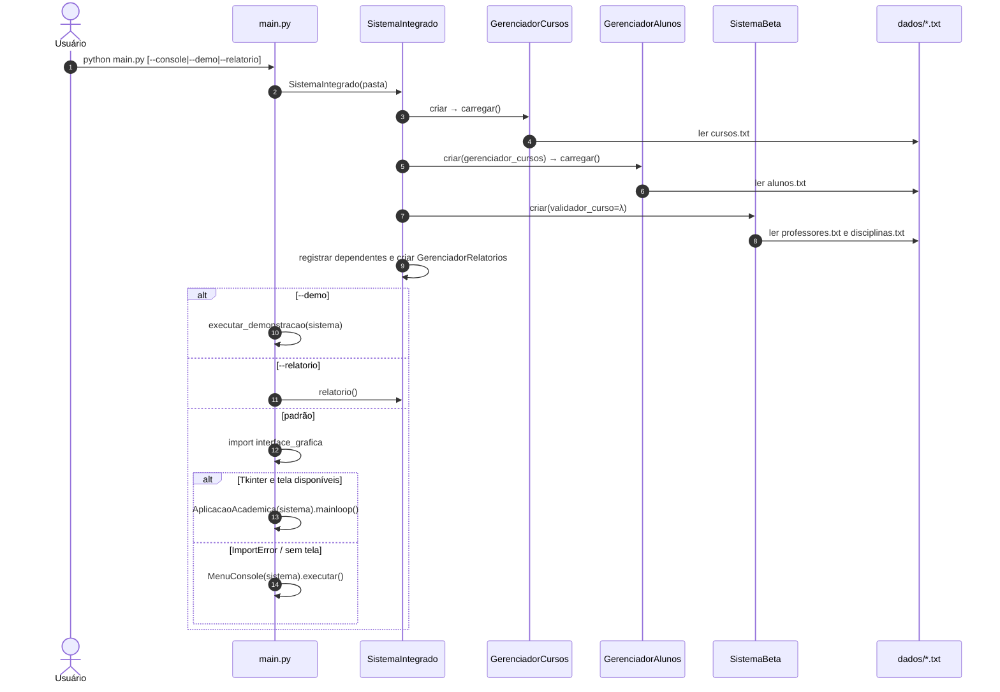
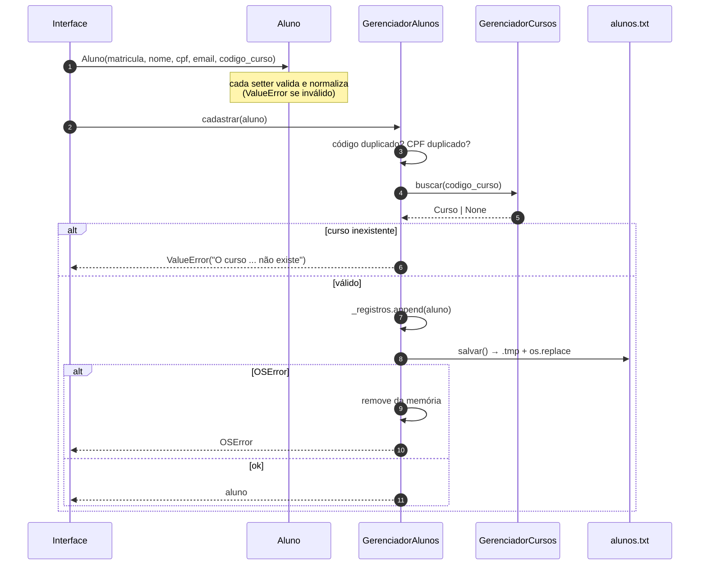
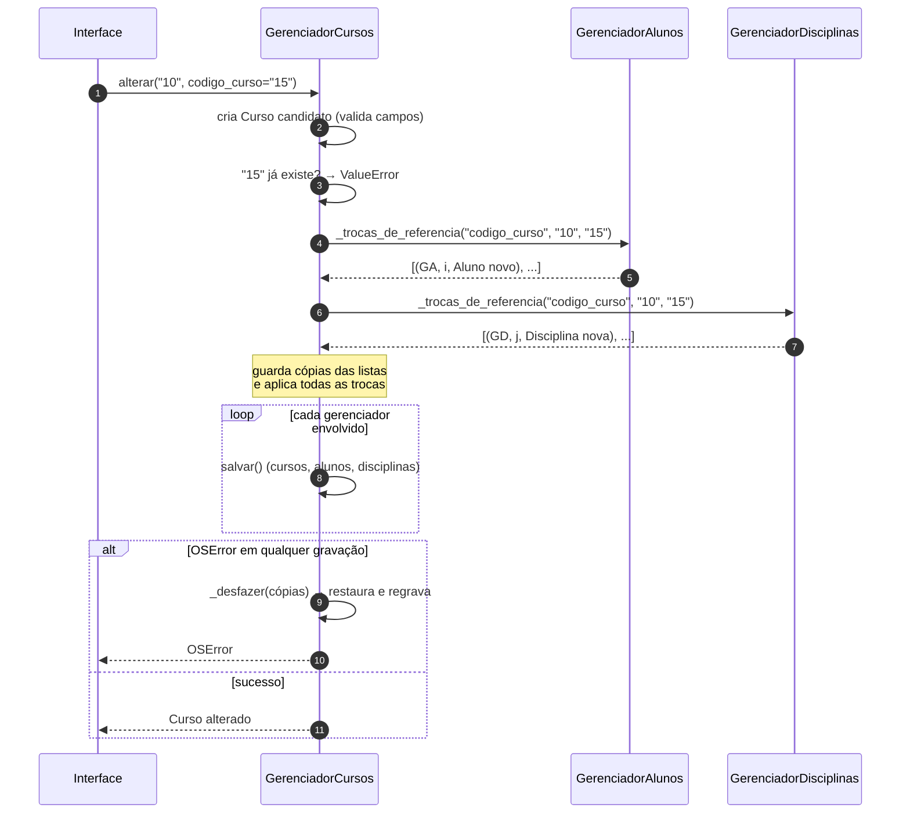
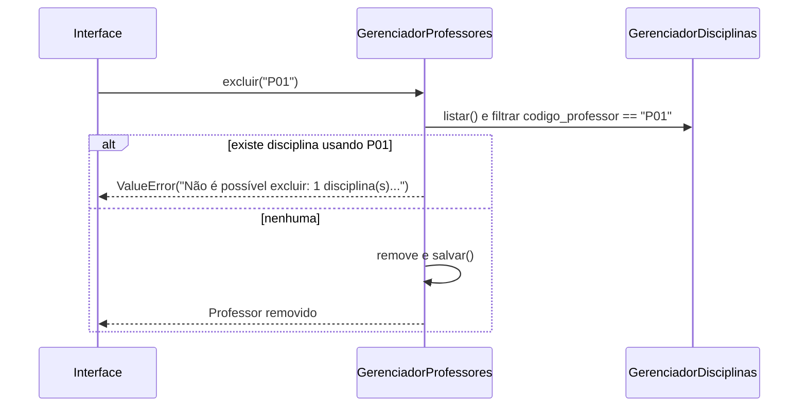
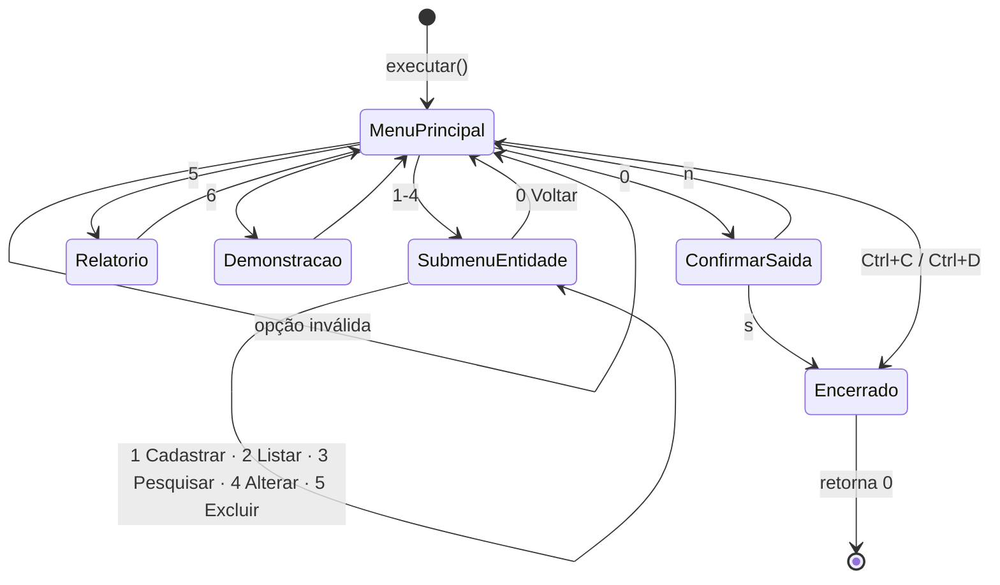
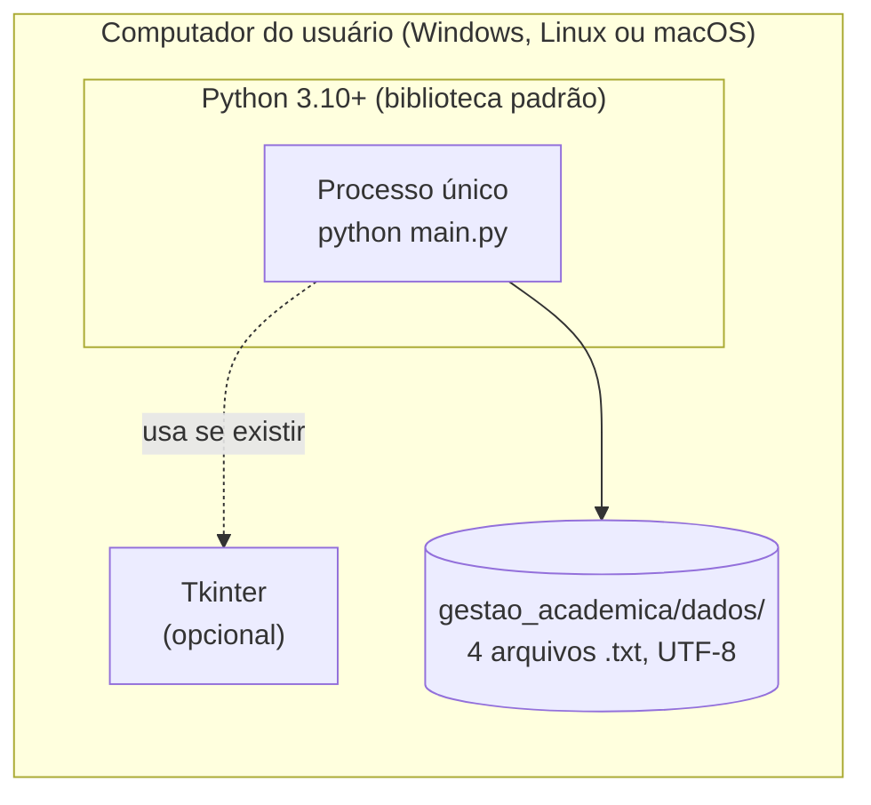
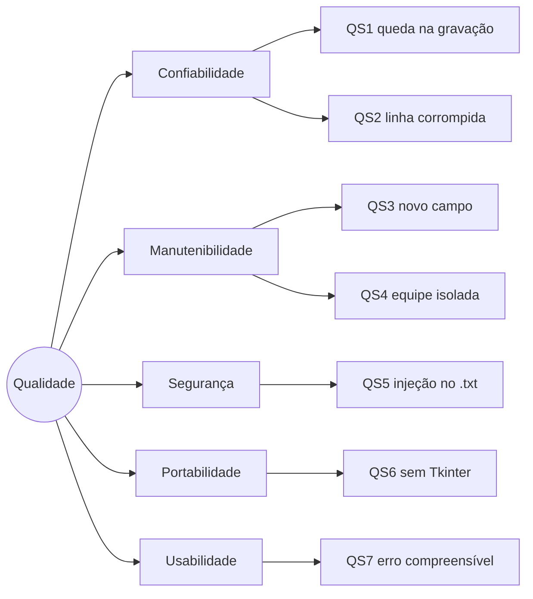

# Documentação de Arquitetura — Sistema de Gestão Acadêmica

> Estrutura baseada no template **arc42** (v8), com diagramas no modelo **C4**
> (Contexto, Contêiner, Componente) e **UML** (sequência e estados).
> Os diagramas usam **Mermaid** e são renderizados no GitHub, no GitLab e no VS Code
> (extensão *Markdown Preview Mermaid Support*).

| Campo | Valor |
|-------|-------|
| Versão do sistema | 1.2.0 (ver [CHANGELOG](../../CHANGELOG.md)) |
| Público-alvo | Quem vai manter, corrigir ou estender o código |
| Leitura mínima antes de alterar código | Seções 1, 4, 5 e 8 |

---

## Sumário

1. [Introdução e objetivos](#1-introdução-e-objetivos)
2. [Restrições](#2-restrições)
3. [Contexto e escopo (C4 nível 1)](#3-contexto-e-escopo-c4-nível-1)
4. [Estratégia da solução](#4-estratégia-da-solução)
5. [Visão de blocos de construção (C4 níveis 2 e 3)](#5-visão-de-blocos-de-construção)
6. [Visão de execução (UML sequência)](#6-visão-de-execução)
7. [Visão de implantação](#7-visão-de-implantação)
8. [Conceitos transversais](#8-conceitos-transversais)
9. [Decisões de arquitetura](#9-decisões-de-arquitetura)
10. [Requisitos de qualidade](#10-requisitos-de-qualidade)
11. [Riscos e débito técnico](#11-riscos-e-débito-técnico)
12. [Glossário](#12-glossário)

---

## 1. Introdução e objetivos

### 1.1 Propósito

Sistema desktop, em Python, para cadastrar e relacionar **Cursos, Alunos, Professores e
Disciplinas** de uma instituição de ensino. Os dados ficam em arquivos de texto. O
sistema foi construído por duas equipes, cada uma dona de duas entidades, e depois
integrado:

| Equipe | Núcleo | Entidades |
|--------|--------|-----------|
| ALFA | Discentes e estrutura | Aluno, Curso |
| BETA | Docente e pedagógico | Professor, Disciplina |

Os requisitos funcionais completos estão em
[docs/requisitos/especificacao.md](../requisitos/especificacao.md).

### 1.2 Objetivos de qualidade (prioridade decrescente)

| # | Objetivo | Por quê | Como é atingido |
|---|----------|---------|-----------------|
| Q1 | **Integridade dos dados** | Os `.txt` são a única fonte de verdade; um arquivo corrompido perde dados reais | Validação em todos os campos, gravação atômica, integridade referencial, rollback |
| Q2 | **Manutenibilidade** | Projeto acadêmico que será modificado por outras pessoas | Gerenciador genérico, regras num só lugar, docstrings, ADRs, fitness functions |
| Q3 | **Independência entre equipes** | ALFA e BETA desenvolvem e testam separadas | Dependências só para o `nucleo`; a ligação acontece apenas no `SistemaIntegrado` |
| Q4 | **Portabilidade** | Precisa rodar no laboratório, sem instalar nada | Somente biblioteca padrão; a GUI cai para o console se o Tkinter faltar |

### 1.3 Partes interessadas

| Papel | Expectativa |
|-------|-------------|
| Professor / avaliador | Requisitos do enunciado atendidos, POO correta, código organizado |
| Equipes ALFA e BETA | Trabalhar em paralelo sem quebrar o módulo da outra equipe |
| Usuário (secretaria) | Cadastrar e consultar sem conhecer o formato dos arquivos |
| Mantenedor futuro | Entender onde mexer e o que pode quebrar |

---

## 2. Restrições

| Tipo | Restrição | Origem | Consequência no projeto |
|------|-----------|--------|-------------------------|
| Técnica | Python, Programação Orientada a Objetos | Enunciado | Classes de entidade e gerenciadoras |
| Técnica | Persistência em `.txt`, campos separados por `;` | Enunciado (RF10) | Sem banco de dados; o `;` é proibido nos dados |
| Técnica | Nomes fixos: `alunos.txt`, `cursos.txt`, `professores.txt`, `disciplinas.txt` | Enunciado | Definidos nos construtores dos gerenciadores |
| Técnica | Atributos protegidos com `@property` | Enunciado (4.A) | Fábrica `propriedade()` em `nucleo/entidade.py` |
| Técnica | Carregar tudo ao iniciar, gravar a cada escrita | RF11, RF12 | Dados em memória; o arquivo inteiro é regravado em cada escrita |
| Técnica | Ponto de entrada único `main.py` | RF16 | Todos os modos de execução saem dele |
| Técnica | Somente biblioteca padrão | Decisão (Q4) | Tkinter para a GUI, `unittest` para os testes |
| Organizacional | Duas equipes com módulos separados | Enunciado | Pacotes `alfa/` e `beta/` + `nucleo/` compartilhado |
| Convenção | Identificadores e mensagens em português | Contexto acadêmico | Ver [CONTRIBUTING](../../CONTRIBUTING.md) |

---

## 3. Contexto e escopo (C4 nível 1)



**Fora do escopo:** autenticação, múltiplos usuários simultâneos, rede, banco de dados,
importação ou exportação de outros formatos. Ver os riscos R1 e R2 na seção 11.

---

## 4. Estratégia da solução

| Problema | Estratégia | Padrão | ADR |
|----------|-----------|--------|-----|
| Quatro entidades com o mesmo CRUD | Uma classe `Gerenciador` genérica; as subclasses só configuram | *Template Method* + *Repository* | [ADR-002](../adr/ADR-002-gerenciador-generico.md) |
| Validar todo dado que entra, venha da GUI, do console ou do `.txt` | Validação no setter de cada atributo | *Property factory* / *Descriptor* | [ADR-003](../adr/ADR-003-validacao-nas-propriedades.md) |
| BETA precisa do curso da ALFA sem depender dela | Injetar uma função `validador_curso` | *Dependency Injection* (callback) | [ADR-004](../adr/ADR-004-independencia-da-beta.md) |
| Não corromper arquivos | Gravar em `.tmp` e trocar com `os.replace` | *Atomic write* | [ADR-005](../adr/ADR-005-gravacao-atomica.md) |
| Vínculos entre arquivos sem banco de dados | Lista `dependentes`: bloqueia exclusão e propaga troca de código | Integridade referencial manual | [ADR-006](../adr/ADR-006-integridade-referencial.md) |
| Duas interfaces com o mesmo comportamento | Interfaces finas sobre uma fachada única | *Facade* | [ADR-007](../adr/ADR-007-fachada-e-interfaces.md) |
| Entidade só com dados (dica do enunciado) | Conversão objeto ↔ linha dentro do gerenciador | Separação de responsabilidades | [ADR-008](../adr/ADR-008-serializacao-no-gerenciador.md) |
| Relatório rápido e testável | Classe própria com índices em dicionário | *Service* + *Hash join* | [ADR-009](../adr/ADR-009-relatorio-com-indices.md) |
| Impedir que a arquitetura se degrade | Testes que verificam importações e docstrings | *Fitness functions* | [ADR-010](../adr/ADR-010-fitness-functions.md) |

---

## 5. Visão de blocos de construção

### 5.1 Nível 2 — Contêineres e camadas

O sistema é um único processo Python. As "camadas" são pacotes e módulos com **regras
de dependência estritas**, verificadas automaticamente por `testes/test_arquitetura.py`.



**Regras de dependência** (uma seta significa "pode importar"):

| Módulo | Pode importar | Não pode importar | Motivo |
|--------|---------------|-------------------|--------|
| `nucleo` | só a biblioteca padrão | tudo do projeto | Base reutilizável e estável |
| `alfa` | `nucleo` | `beta`, interfaces | Equipe independente |
| `beta` | `nucleo` | `alfa`, interfaces | Equipe independente ([ADR-004](../adr/ADR-004-independencia-da-beta.md)) |
| `avaliacao` | `nucleo` | `alfa`, `beta`, interfaces | Recebe alunos e disciplinas por injeção ([ADR-011](../adr/ADR-011-modulo-de-avaliacao.md)) |
| `relatorios` | nada interno (recebe objetos prontos) | — | Testável com qualquer fonte de dados |
| `sistema` | `alfa`, `beta`, `avaliacao`, `relatorios` | interfaces | Integração não depende da apresentação |
| interfaces | `sistema`, `demonstracao`, `avaliacao` (só a classe `Nota`) | `nucleo`, `alfa.gerenciadores`, `beta.integracao` | As regras ficam fora da apresentação |

### 5.2 Nível 3 — Componentes

| Componente | Arquivo | Responsabilidade | Requisitos |
|------------|---------|------------------|------------|
| `propriedade()` | `nucleo/entidade.py` | Cria o atributo protegido e o `@property` com validação | 4.A, RF06–RF09 |
| `validar_*` | `nucleo/entidade.py` | Regras genéricas de código, nome, CPF, e-mail, modalidade e carga horária | RF06–RF09 |
| `Entidade` | `nucleo/entidade.py` | Base dos modelos; declara `CAMPOS` | 4.A |
| `Gerenciador` | `nucleo/gerenciador.py` | CRUD, conversão para `.txt`, carga, gravação atômica, unicidade, dependentes e cascata | RF01–RF05, RF10–RF12 |
| `Aluno`, `Curso` | `alfa/aluno.py`, `alfa/curso.py` | Modelos de dados da ALFA | RF06, RF07 |
| `GerenciadorAlunos`, `GerenciadorCursos` | `alfa/gerenciadores.py` | Configuração e regra RF13 | RF13 |
| `Professor`, `Disciplina` | `beta/professor.py`, `beta/disciplina.py` | Modelos de dados da BETA | RF08, RF09 |
| `GerenciadorProfessores`, `GerenciadorDisciplinas`, `SistemaBeta` | `beta/integracao.py` | Configuração e regra RF14; núcleo BETA isolado | RF14 |
| `SistemaIntegrado`, `ENTIDADES` | `sistema.py` | Monta e conecta tudo; metadados para as interfaces | integração |
| `GerenciadorRelatorios`, `LinhaRelatorio` | `relatorios.py` | Relatório consolidado | RF15 |
| `MenuConsole` | `menu_console.py` | Menu de terminal | RF17, RF18 |
| `AplicacaoAcademica` | `interface_grafica.py` | Janela Tkinter | RF17, RF18, Desafio |
| `executar_demonstracao` | `demonstracao.py` | Fluxo guiado da Seção 5 do enunciado | Integração Final |

O diagrama de classes completo (UML), os cartões CRC e os contratos de cada método
estão em [docs/projeto/modelo-de-classes.md](../projeto/modelo-de-classes.md).

### 5.3 Metadados `ENTIDADES`

`sistema.ENTIDADES` descreve cada entidade para as interfaces: título, nome do atributo
do gerenciador, classe e lista de `(campo, rótulo)`. É isso que torna o console e a GUI
**genéricos**: nenhum dos dois tem código específico por entidade.

```python
"curso": dict(titulo="Cursos", gerente="cursos", classe=Curso, campos=[
    ("codigo_curso", "Código do curso"), ("nome", "Nome"), ("modalidade", "Modalidade (Presencial/EAD)")]),
```

> ⚠️ A ordem e os nomes em `campos` precisam coincidir com `Classe.CAMPOS`. Veja o
> débito técnico D3 na seção 11.

---

## 6. Visão de execução

### 6.1 Inicialização (RF11 e RF16)



Linhas inválidas do `.txt` **não interrompem** a carga. Elas vão para
`linhas_ignoradas` e aparecem como aviso na interface.

### 6.2 Cadastro com validação de vínculo (RF01, RF13 e RF12)



### 6.3 Alteração de código com cascata (RF04)



O ponto central do desenho é que **todas as trocas são montadas antes de aplicar a
primeira**. Um erro de validação nesse ponto não deixa nenhum efeito colateral.

### 6.4 Exclusão bloqueada (RF05 + integridade)



### 6.5 Navegação do console (RF17 e RF18)



---

## 7. Visão de implantação



| Item | Detalhe |
|------|---------|
| Instalação | Copiar a pasta. Não há `pip install` |
| Versão mínima | Python 3.10 (por causa da sintaxe `str \| None` em `relatorios.py`) |
| GUI no Linux | Pode exigir o pacote `python3-tk` |
| Dados | `dados/` ao lado do código, ou outra pasta via `--dados` |
| Arquivos gerados | `*.tmp`, que existe só durante a gravação, e `*.bak`, criado se houver linhas ignoradas |
| Backup recomendado | Copiar a pasta `dados/` |

---

## 8. Conceitos transversais

### 8.1 Validação em três níveis

| Nível | Onde | O que verifica | Exemplo |
|-------|------|----------------|---------|
| 1. Comum | `propriedade()` → setter | Não vazio, sem `;`, sem caracteres de controle | `"Ana;X"` → erro |
| 2. Campo | `validar_*` | Formato e normalização | `"12345678901"` → `"123.456.789-01"` |
| 3. Contexto | `Gerenciador` | Chave e campos únicos, vínculos | Curso `"99"` inexistente → erro |

Como a validação mora nos setters, **todo caminho de entrada é coberto**: GUI, console,
demonstração e até a leitura do `.txt`, porque o construtor passa pelos setters.

### 8.2 Contrato de erros

As interfaces só precisam tratar estas exceções. Nenhuma outra deve escapar da camada
de domínio.

| Exceção | Significado | Tratamento na interface |
|---------|-------------|-------------------------|
| `ValueError` | Dado inválido, duplicado ou regra de integridade violada | Mostrar a mensagem, que já vem pronta para o usuário |
| `LookupError` | Código não encontrado | Mostrar a mensagem |
| `TypeError` | Objeto da classe errada passado ao gerenciador (erro de programação) | Mostrar a mensagem |
| `OSError` | Falha de disco ou permissão | Mostrar a mensagem; os dados em memória já foram revertidos |

As mensagens são escritas para o usuário final, em português e com orientação de como
corrigir. Exemplo: "Cadastre o curso primeiro."

### 8.3 Persistência

- **Formato:** uma linha por registro, campos na ordem de `CAMPOS`, separados por
  `SEPARADOR = ";"`, UTF-8, quebra de linha `\n`.
- **Carga:** tolerante. Uma linha ruim é ignorada e registrada, sem derrubar o programa.
- **Gravação:** o arquivo inteiro é escrito em `arquivo.txt.tmp` e depois trocado com
  `os.replace`, que é atômico no mesmo sistema de arquivos.
- **Backup:** se houver linhas ignoradas, um `arquivo.txt.bak` é criado antes da primeira
  regravação, para não perder o que o programa não entendeu.
- **Consistência memória ↔ disco:** toda operação de escrita desfaz a mudança em memória
  se a gravação falhar.

Detalhes e dicionário de dados: [docs/projeto/modelo-de-dados.md](../projeto/modelo-de-dados.md).

### 8.4 Normalização para busca

`normalizar()` remove acentos (Unicode NFD) e põe tudo em minúsculas. Por isso "joao"
encontra "João". A comparação de **códigos** é exata; a de **nomes** aceita trechos.

### 8.5 Segurança

| Ameaça | Mitigação |
|--------|-----------|
| Injeção de colunas ou linhas no `.txt` via `;` ou `\n` | Recusados no setter (nível 1) |
| Sequências ANSI ou caracteres de controle manipulando o terminal | Todo caractere com código < 32 e o 127 são recusados |
| Caminho de arquivo controlado pelo usuário | Os nomes dos arquivos são fixos; só a pasta é configurável, via linha de comando |
| Execução de código a partir dos dados | Os dados nunca passam por `eval`/`exec`; só `split` e construtores |
| Dados pessoais (CPF, e-mail) | Ficam em texto puro no disco. Proteja a pasta `dados/` (risco R4) |

### 8.6 Internacionalização e acessibilidade

Interface só em português. A GUI usa a fonte Segoe UI (no Linux, o Tk substitui por uma
equivalente) e tem navegação por teclado nos formulários (Enter salva, Esc cancela) e
Ctrl+Q para sair.

---

## 9. Decisões de arquitetura

Registradas como ADRs em [docs/adr/](../adr/README.md):

| ADR | Decisão | Status |
|-----|---------|--------|
| [001](../adr/ADR-001-persistencia-txt.md) | Persistência em `.txt` com `;` | Aceita |
| [002](../adr/ADR-002-gerenciador-generico.md) | Gerenciador genérico com Template Method | Aceita |
| [003](../adr/ADR-003-validacao-nas-propriedades.md) | Validação nos setters via fábrica de propriedades | Aceita |
| [004](../adr/ADR-004-independencia-da-beta.md) | BETA independente da ALFA via injeção de validador | Aceita |
| [005](../adr/ADR-005-gravacao-atomica.md) | Gravação atômica com arquivo temporário | Aceita |
| [006](../adr/ADR-006-integridade-referencial.md) | Bloquear exclusão e cascatear a troca de código | Aceita |
| [007](../adr/ADR-007-fachada-e-interfaces.md) | Fachada única + duas interfaces + fallback para console | Aceita |
| [008](../adr/ADR-008-serializacao-no-gerenciador.md) | Conversão para `.txt` no gerenciador, não na entidade | Aceita |
| [009](../adr/ADR-009-relatorio-com-indices.md) | Relatório em gerenciador próprio com índices | Aceita |
| [010](../adr/ADR-010-fitness-functions.md) | Regras de arquitetura verificadas por testes | Aceita |
| [011](../adr/ADR-011-modulo-de-avaliacao.md) | Módulo de Avaliação: pacote próprio, chave composta, média calculada | Aceita |

---

## 10. Requisitos de qualidade

### 10.1 Árvore de qualidade (ISO/IEC 25010)



### 10.2 Cenários de qualidade

| ID | Estímulo | Resposta esperada | Medida | Verificado por |
|----|----------|-------------------|--------|----------------|
| QS1 | O disco falha durante a alteração de um código com cascata | Memória e arquivos voltam ao estado anterior | 0 registros divergentes | `test_rf04_falha_de_disco_na_cascata_desfaz_tudo` |
| QS2 | O `.txt` tem uma linha com campos a menos | O sistema abre, ignora a linha, avisa e cria um `.bak` antes de regravar | Programa não encerra | Comportamento de `carregar()` |
| QS3 | O mantenedor precisa de um novo campo numa entidade | Mudança em no máximo 3 arquivos, sem tocar nas interfaces | ≤ 3 arquivos | [Guia de manutenção, receita 1](../manutencao/guia-de-manutencao.md#receita-1--adicionar-um-campo-a-uma-entidade) |
| QS4 | A BETA roda os testes sem o pacote `alfa` | `SistemaBeta` funciona sozinho | 0 importações de `alfa` em `beta/` | `test_beta_e_independente_da_alfa` |
| QS5 | O usuário digita `Ana;123` ou um caractere ESC | O cadastro é recusado com mensagem | 0 linhas corrompidas | `test_campo_vazio_ou_com_separador_e_rejeitado`, `test_caracteres_de_controle_sao_bloqueados` |
| QS6 | O sistema é executado num ambiente sem Tkinter | O menu de console abre automaticamente | Código de saída 0 | `abrir_interface_grafica` em `main.py` |
| QS7 | O usuário cadastra um aluno com um curso inexistente | A mensagem diz o que fazer ("Cadastre o curso primeiro") | Sem *stack trace* | `test_rf13_aluno_exige_curso_existente` |

---

## 11. Riscos e débito técnico

O registro completo, com probabilidade, impacto e plano, está em
[docs/qualidade/riscos-e-divida-tecnica.md](../qualidade/riscos-e-divida-tecnica.md).
Os principais itens:

| ID | Item | Impacto |
|----|------|---------|
| R1 | Duas instâncias abertas ao mesmo tempo: a última gravação vence | Perda de alterações |
| R2 | Queda de energia **entre** a gravação de dois arquivos na cascata | Vínculo inconsistente entre arquivos |
| D1 | Cada escrita regrava o arquivo inteiro (imposto pelo RF12) | Lento acima de cerca de 100 mil registros |
| D3 | `ENTIDADES` repete os nomes de `CAMPOS` | Esquecer de atualizar um dos dois |

---

## 12. Glossário

Ver [docs/glossario.md](../glossario.md).
