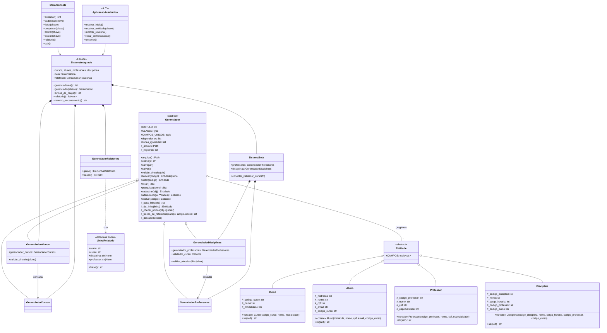

# Modelo de Classes e Contratos

## 1. Diagrama de classes (UML)



> **Notação UML:** `+` público · `#` protegido (convenção `_nome` do Python) ·
> sublinhado/`$` estático · `«create»` construtor (`__init__`) · `str(self)` representa
> `__str__`. Os atributos protegidos das entidades (`#_cpf`) são expostos por `@property`
> com o mesmo nome, sem o `_` (`aluno.cpf`).

## 2. Cartões CRC (Classe, Responsabilidade, Colaboradores)

| Classe | Responsabilidades | Colaboradores |
|--------|-------------------|---------------|
| **Entidade** (e subclasses) | Guardar os atributos; validar e normalizar cada valor no setter; exibir-se (`__str__`); declarar a ordem dos campos | `propriedade()`, `validar_*` |
| **Gerenciador** | Manter a lista em memória; converter de e para `.txt`; carregar e gravar com segurança; garantir chaves e campos únicos; bloquear exclusões com dependentes; cascatear a troca de código | Entidade, sistema de arquivos, outros Gerenciadores (dependentes) |
| **GerenciadorAlunos** | Exigir um curso existente (RF13) | GerenciadorCursos |
| **GerenciadorDisciplinas** | Exigir professor e curso existentes (RF14) | GerenciadorProfessores, `validador_curso` |
| **GerenciadorNotas** | Chave composta (matrícula + disciplina); exigir aluno e disciplina existentes (RF19); reler o `notas.txt` antes de listar e gravar (RF24) | GerenciadorAlunos, GerenciadorDisciplinas |
| **GerenciadorRendimento** | Resolver nomes e produzir as linhas do relatório de rendimento com média e status (RF23) | GerenciadorNotas, alunos, disciplinas, `media_ponderada`, `status` |
| **SistemaBeta** | Montar a BETA isolada e ligar professor → disciplinas | Gerenciadores BETA |
| **SistemaIntegrado** | Montar tudo na ordem certa; conectar ALFA e BETA; registrar dependentes; ser a fachada das interfaces | Todos os gerenciadores, GerenciadorRelatorios |
| **GerenciadorRelatorios** | Cruzar as entidades e produzir as linhas do RF15 | 4 gerenciadores, LinhaRelatorio |
| **MenuConsole** / **AplicacaoAcademica** | Coletar a entrada, chamar o domínio, mostrar o resultado ou o erro, confirmar a saída | SistemaIntegrado, `ENTIDADES` |

## 3. Padrões de projeto utilizados

| Padrão | Onde | Para quê |
|--------|------|----------|
| **Template Method** | `Gerenciador.cadastrar/alterar` chamam o gancho `validar_vinculos` | Fluxo fixo, regra variável por entidade |
| **Repository** | `Gerenciador` | Isolar o "como guardar" do "o que é" |
| **Facade** | `SistemaIntegrado` | Interface única e simples para a apresentação |
| **Dependency Injection** | `validador_curso`, `GerenciadorRelatorios(...)`, `MenuConsole(entrada, saida)`, `main` → interfaces | Desacoplar e testar |
| **Factory (de propriedades)** | `propriedade()` | Gerar as 17 `@property` sem repetição |
| **Command table** | Dicionários `{tecla: (rótulo, função)}` no `MenuConsole` | Adicionar uma opção sem `if/elif` |
| **Value Object** | `LinhaRelatorio` (dataclass `frozen`) | Dado imutável do relatório |
| **Metadata-driven UI** | `sistema.ENTIDADES` | Interfaces genéricas para qualquer entidade |

## 4. Contrato do `Gerenciador` (API pública)

Toda subclasse herda este contrato. Os códigos são comparados **depois de `strip()`**.

| Método | Pré-condição | Pós-condição (sucesso) | Exceções |
|--------|--------------|------------------------|----------|
| `carregar()` | — | `_registros` reflete o `.txt`; linhas inválidas em `linhas_ignoradas` | `OSError` (sem permissão) |
| `salvar()` | — | O `.txt` é idêntico à memória | `OSError` |
| `buscar(codigo)` | — | Retorna o objeto ou `None` | — |
| `obter(codigo)` | — | Retorna o objeto | `LookupError` |
| `listar()` | — | Retorna uma **cópia** da lista | — |
| `pesquisar(termo)` | — | Registros com o código igual ou o nome contendo o termo (sem acentos e sem diferenciar maiúsculas); `[]` se o termo for vazio | — |
| `cadastrar(obj)` | `obj` é instância de `CLASSE` | `obj` na memória e no disco | `TypeError`, `ValueError`, `OSError` |
| `alterar(codigo, **dados)` | `codigo` existe; chaves de `dados` ⊆ `CAMPOS` | O registro é substituído por um novo objeto; dependentes atualizados se o código mudou; arquivos gravados | `LookupError`, `ValueError`, `OSError` (com rollback) |
| `excluir(codigo)` | `codigo` existe e não tem dependentes | O registro sai da memória e do disco | `LookupError`, `ValueError`, `OSError` |

**Gancho para as subclasses:**

| Membro | Obrigatório | Descrição |
|--------|-------------|-----------|
| `ROTULO` | sim | Nome singular nas mensagens |
| `CLASSE` | sim | Classe da entidade; `CLASSE.CAMPOS[0]` é a chave |
| `CAMPOS_UNICOS` | não | Campos (além da chave) que não podem repetir |
| `validar_vinculos(obj)` | não | Levanta `ValueError` se uma referência não existir |
| atributos usados por `validar_vinculos` | — | Devem ser atribuídos **antes** de `super().__init__()`, que já chama `carregar()` |

### 4.1 Chave composta (ADR-011)

O identificador de um registro vem de `identificador(obj)`, que por padrão é o primeiro
campo. Quem tem chave composta sobrescreve `identificador`, `_normalizar_id` e
`_texto_id` (como `GerenciadorNotas`, que aceita `("202301", "D01")` ou `"202301/D01"`).

## 5. Contrato do `SistemaIntegrado` (usado pelas interfaces)

| Membro | Retorno | Uso |
|--------|---------|-----|
| `gerenciador(chave)` | `Gerenciador` | `chave` ∈ {`curso`, `aluno`, `professor`, `disciplina`} |
| `gerenciadores()` | `list[Gerenciador]` | Iterar sobre todos (avisos, contadores) |
| `avisos_de_carga()` | `list[str]` | Mostrar as linhas ignoradas ao abrir |
| `relatorio()` | `list[str]` | Frases do RF15 |
| `relatorios.gerar()` | `list[LinhaRelatorio]` | Relatório estruturado (para exportar etc.) |
| `relatorio_rendimento()` | `list[LinhaRendimento]` | Relatório de rendimento escolar (RF23), média recalculada a cada chamada |
| `resumo_encerramento()` | `str` | Mensagem da saída (RF18) |
| `cursos`, `alunos`, `professores`, `disciplinas` | `Gerenciador` | Acesso direto, quando necessário |
| `notas` | `GerenciadorNotas` | Notas e pesos; identificador é a tupla `(matricula, codigo_disciplina)` (ADR-011) |

## 6. Mecanismo da `propriedade()`

```python
def propriedade(nome, rotulo, validar=None):
    atributo = "_" + nome                      # ex.: "_cpf" (atributo protegido)
    def getter(self): return getattr(self, atributo)
    def setter(self, valor):
        texto = str(valor).strip()
        # regras comuns: não vazio, sem controle, sem ';'
        setattr(self, atributo, validar(texto, rotulo) if validar else texto)
    return property(getter, setter)

class Aluno(Entidade):
    cpf = propriedade("cpf", "O CPF", validar_cpf_aluno)   # cria Aluno.cpf como property

a = Aluno(..., cpf="12345678901", ...)
a.cpf      # "123.456.789-01"  (getter)
a._cpf     # mesmo valor, armazenamento interno
a.cpf = "" # ValueError: "O CPF não pode ficar vazio."
```

As funções `validar_*` seguem a assinatura `validar(texto: str, rotulo: str) -> valor`. O
valor de retorno é o que fica guardado, e é por isso que elas podem normalizar (máscara
de CPF, `int` da carga horária).
