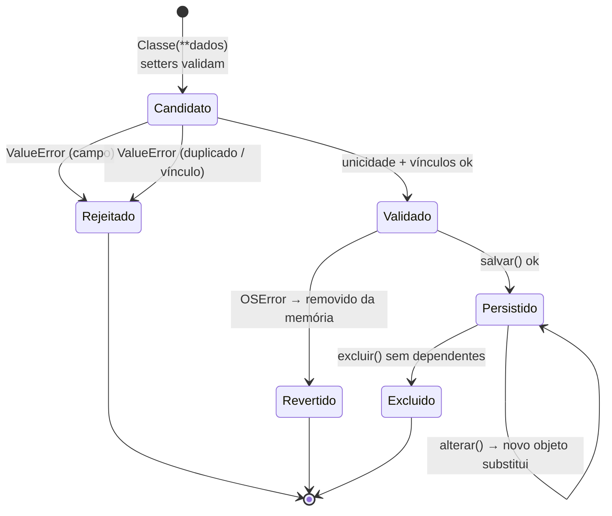

# Modelo de Dados

## 1. Diagrama Entidade-Relacionamento

```mermaid
erDiagram
    CURSO ||--o{ ALUNO : "matricula"
    CURSO ||--o{ DISCIPLINA : "oferece"
    PROFESSOR ||--o{ DISCIPLINA : "leciona"
    ALUNO ||--o{ NOTA : "recebe"
    DISCIPLINA ||--o{ NOTA : "avalia"

    CURSO {
        str codigo_curso PK
        str nome
        str modalidade "Presencial | EAD"
    }
    ALUNO {
        str matricula PK
        str nome
        str cpf UK "000.000.000-00"
        str email
        str codigo_curso FK
    }
    PROFESSOR {
        str codigo_professor PK
        str nome
        str cpf UK "000.000.000-00"
        str especialidade
    }
    DISCIPLINA {
        str codigo_disciplina PK
        str nome
        int carga_horaria "maior que 0"
        str codigo_professor FK
        str codigo_curso FK
    }
    NOTA {
        str matricula PK_FK "chave composta"
        str codigo_disciplina PK_FK "chave composta"
        decimal nota1 "0.0 a 10.0"
        decimal peso1 "maior ou igual a 0"
        decimal nota2
        decimal peso2
        decimal nota3
        decimal peso3
    }
```

**Cardinalidades:**

- Um curso tem 0..N alunos e 0..N disciplinas.
- Um professor leciona 0..N disciplinas.
- Cada aluno pertence a exatamente 1 curso.
- Cada disciplina tem exatamente 1 professor e 1 curso.
- Um aluno tem 0..1 registro de notas por disciplina; cada registro pertence a 1 aluno e 1 disciplina.

**Relação derivada (relatório):** um aluno "assiste" a todas as disciplinas do seu curso.
Não há matrícula individual em disciplina; ver a evolução E2 em
[riscos-e-divida-tecnica.md](../qualidade/riscos-e-divida-tecnica.md).

## 2. Dicionário de dados

Legenda: **PK** = chave primária · **UK** = valor único · **FK** = referência a outra entidade.

### 2.1 Curso — `cursos.txt` (Equipe ALFA)

| # | Campo | Tipo | Chave | Regra | Exemplo |
|---|-------|------|-------|-------|---------|
| 1 | `codigo_curso` | str | PK | 1–24 caracteres `[A-Za-z0-9_-]`, começando por letra ou número | `10` |
| 2 | `nome` | str | | 1–120 caracteres, ao menos uma letra | `Análise e Desenvolvimento de Sistemas` |
| 3 | `modalidade` | str | | `Presencial` ou `EAD` (normalizado) | `Presencial` |

### 2.2 Aluno — `alunos.txt` (Equipe ALFA)

| # | Campo | Tipo | Chave | Regra | Exemplo |
|---|-------|------|-------|-------|---------|
| 1 | `matricula` | str | PK | mesma regra de código | `202301` |
| 2 | `nome` | str | | 1–120 caracteres, ao menos uma letra | `João Silva` |
| 3 | `cpf` | str | UK | 11 dígitos, com ou sem máscara; gravado com máscara | `123.456.789-00` |
| 4 | `email` | str | | `local@dominio.tld`, até 254 caracteres | `joao.silva@email.com` |
| 5 | `codigo_curso` | str | FK → Curso | o curso precisa existir | `10` |

### 2.3 Professor — `professores.txt` (Equipe BETA)

| # | Campo | Tipo | Chave | Regra | Exemplo |
|---|-------|------|-------|-------|---------|
| 1 | `codigo_professor` | str | PK | mesma regra de código | `P01` |
| 2 | `nome` | str | | 1–120 caracteres, ao menos uma letra | `Carlos Souza` |
| 3 | `cpf` | str | UK | igual ao CPF do aluno | `111.222.333-44` |
| 4 | `especialidade` | str | | 1–120 caracteres, ao menos uma letra | `Programação Orientada a Objetos` |

### 2.4 Disciplina — `disciplinas.txt` (Equipe BETA)

| # | Campo | Tipo | Chave | Regra | Exemplo |
|---|-------|------|-------|-------|---------|
| 1 | `codigo_disciplina` | str | PK | mesma regra de código | `D01` |
| 2 | `nome` | str | | 1–120 caracteres, ao menos uma letra | `Programação Orientada a Objetos` |
| 3 | `carga_horaria` | int | | inteiro > 0 | `80` |
| 4 | `codigo_professor` | str | FK → Professor | o professor precisa existir | `P01` |
| 5 | `codigo_curso` | str | FK → Curso | o curso precisa existir | `10` |

### 2.5 Nota — `notas.txt` (Módulo de Avaliação)

| # | Campo | Tipo | Chave | Regra | Exemplo |
|---|-------|------|-------|-------|---------|
| 1 | `matricula` | str | PK (composta) + FK → Aluno | o aluno precisa existir | `202301` |
| 2 | `codigo_disciplina` | str | PK (composta) + FK → Disciplina | a disciplina precisa existir | `D01` |
| 3 | `nota1` | decimal | | 0.0 a 10.0 | `8.5` |
| 4 | `peso1` | decimal | | ≥ 0 | `2` |
| 5 | `nota2` | decimal | | 0.0 a 10.0 | `7.0` |
| 6 | `peso2` | decimal | | ≥ 0 | `3` |
| 7 | `nota3` | decimal | | 0.0 a 10.0 | `9.0` |
| 8 | `peso3` | decimal | | ≥ 0; a soma dos três pesos deve ser > 0 | `5` |

Exemplo de linha: `202301;D01;8.5;2;7.0;3;9.0;5`. A **média não é gravada**: é calculada a
cada leitura (RF21/RF24). Números usam ponto decimal; a vírgula é aceita na digitação e
convertida.

### 2.6 Regras comuns a todos os campos

O valor passa por `strip()` e não pode ser vazio, conter `;` nem caracteres de controle
(códigos 0–31 e 127). Ver `nucleo.entidade.propriedade`.

## 3. Formato físico dos arquivos

| Propriedade | Valor |
|-------------|-------|
| Localização | `dados/` (ou a pasta passada em `--dados`) |
| Codificação | UTF-8. Gravado sem BOM; na leitura, arquivos com BOM também são aceitos |
| Fim de linha | `\n` (LF) na gravação; a leitura aceita `\r\n` |
| Separador | `;` (constante `nucleo.entidade.SEPARADOR`) |
| Cabeçalho | Não há. A ordem das colunas é a de `Classe.CAMPOS` |
| Linhas em branco | Ignoradas na leitura |
| Ordem dos registros | Ordem de inserção |

Exemplo de `disciplinas.txt`:

```
D01;Programação Orientada a Objetos;80;P01;10
D02;Engenharia de Requisitos;60;P02;20
```

### 3.1 Linhas inválidas

Uma linha é **ignorada**, guardada em `Gerenciador.linhas_ignoradas` e mostrada como aviso
quando:

- o número de campos é diferente de `len(CAMPOS)`;
- algum campo viola a sua regra (ex.: carga horária `abc`);
- o código repete um já lido no mesmo arquivo.

Vínculos quebrados num `.txt` editado à mão (ex.: um aluno com um curso inexistente)
**não** invalidam a linha na carga. O registro é carregado e aparece no relatório como
"(curso X não encontrado)". Assim, um arquivo editado fora do sistema não faz dados
sumirem em silêncio.

### 3.2 Arquivos auxiliares

| Arquivo | Quando aparece | O que fazer |
|---------|----------------|-------------|
| `*.txt.tmp` | Só durante a gravação | Se sobrar (queda de energia), pode ser apagado: o `.txt` está íntegro |
| `*.txt.bak` | Primeira gravação após carregar com linhas ignoradas | Conferir as linhas perdidas, corrigir à mão e apagar |

## 4. Integridade referencial

| Operação | Regra | Equivalente SQL |
|----------|-------|-----------------|
| Cadastrar ou alterar um registro com FK | O referenciado precisa existir | `FOREIGN KEY` |
| Excluir um registro referenciado | Bloqueado | `ON DELETE RESTRICT` |
| Alterar a PK de um registro referenciado | Propagado aos dependentes | `ON UPDATE CASCADE` |

Ver o [ADR-006](../adr/ADR-006-integridade-referencial.md).

## 5. Ciclo de vida de um registro em memória



Nas alterações, o objeto **não é modificado no lugar**: um novo objeto é criado, validado
e só então substitui o antigo. É isso que torna a operação "tudo ou nada".
