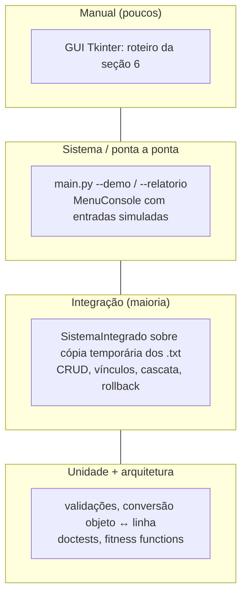

# Estratégia de Testes

## 1. Objetivo

Garantir que cada requisito (RF01–RF18 e os itens do enunciado) continue funcionando
depois de qualquer mudança, e que a arquitetura documentada continue valendo.

```bash
python -m unittest discover -s testes -v     # suíte completa, em menos de 1 segundo
```

Só a biblioteca padrão é usada (`unittest`, `doctest`, `ast`, `tempfile`). Não há nada
para instalar.

## 2. Pirâmide de testes



A camada de **integração** concentra a maioria dos testes, porque o maior risco do
sistema está na combinação "regra + arquivo", e não em funções isoladas.

## 3. Organização

| Arquivo | Conteúdo |
|---------|----------|
| `testes/test_requisitos.py` | Um ou mais testes por RF, agrupados por classe: `TestCrud`, `TestAtributos`, `TestPersistencia`, `TestIntegracao`, `TestInterfaceConsole`, `TestRequisitosTecnicos`, `TestIntegracaoFinal`, `TestPontoDeEntrada` |
| `testes/test_arquitetura.py` | Fitness functions: dependências entre camadas, entidades como modelos de dados, docstrings, existência dos documentos e referência da API atualizada; mais os doctests |

### 3.1 Convenções

- **Nome = especificação:** `test_rf<NN>_<comportamento_esperado>`. O nome do teste já
  diz o que ele garante, e a [matriz de rastreabilidade](../requisitos/especificacao.md#8-matriz-de-rastreabilidade)
  aponta cada RF para os seus testes.
- **Isolamento:** `BaseTeste.setUp` copia `dados/*.txt` para uma pasta temporária e cria
  um `SistemaIntegrado` sobre ela. `tearDown` apaga a pasta. **Nenhum teste toca em `dados/`.**
- **Verificar no arquivo, não só na memória:** use `self.ler("alunos.txt")` para conferir
  o que foi gravado (RF10, RF12).
- **Console sem teclado:** `MenuConsole(sistema, entrada=..., saida=...)` recebe uma
  sequência de respostas (`executar_menu([...])`).
- **Falhas de disco:** substitua `gerenciador.salvar` por uma função que levanta
  `OSError` (ver `test_rf04_falha_de_disco_na_cascata_desfaz_tudo`).

### 3.2 Modelo de um teste novo

```python
class TestIntegracao(BaseTeste):
    def test_rf13_alterar_aluno_para_curso_inexistente_e_rejeitado(self):
        # Arrange: dados padrão já carregados pelo setUp
        antes = self.ler("alunos.txt")
        # Act + Assert
        with self.assertRaises(ValueError):
            self.sistema.alunos.alterar("202301", codigo_curso="999")
        # o arquivo não mudou
        self.assertEqual(antes, self.ler("alunos.txt"))
```

## 4. Dados de teste

`dados/` traz uma massa mínima e consistente, que os testes usam como ponto de partida:

| Arquivo | Registros |
|---------|-----------|
| cursos | `10` ADS (Presencial), `20` Engenharia de Software (EAD) |
| alunos | `202301` João Silva → 10, `202302` Maria Oliveira → 20 |
| professores | `P01` Carlos Souza, `P02` Ana Lima |
| disciplinas | `D01` POO → P01/10, `D02` Engenharia de Requisitos → P02/20 |

⚠️ Vários testes dependem desses registros. Se alterar a massa, rode a suíte e ajuste os testes.

## 5. Fitness functions (testes de arquitetura)

| Teste | Protege | Quando falha |
|-------|---------|--------------|
| `test_camadas_respeitam_as_dependencias_permitidas` | arc42 §5.1 | Uma importação nova atravessa uma camada indevidamente |
| `test_beta_e_independente_da_alfa` | ADR-004 | A BETA passou a importar a ALFA |
| `test_entidades_so_definem_init_e_str` | ADR-008, dica do enunciado | Uma entidade ganhou um método com lógica |
| `test_entidades_nao_acessam_arquivos` | ADR-008 | Uma entidade passou a abrir arquivos |
| `test_cobertura_de_docstrings_e_total` | RNF06 | Uma função ou classe nova não tem docstring |
| `test_documentos_de_arquitetura_existem` | Documentação | Um documento principal foi removido ou renomeado |
| `test_referencia_da_api_esta_atualizada` | `docs/api/referencia.md` | Uma docstring mudou sem regenerar a referência |
| doctests de `nucleo.entidade` | Exemplos das docstrings | Um exemplo deixou de corresponder ao comportamento real |

## 6. Roteiro de teste manual da GUI

A GUI não tem testes automatizados, porque eles exigiriam um servidor gráfico. Após
mudar `interface_grafica.py`, rode `python main.py --dados <cópia>` e verifique:

| # | Passo | Resultado esperado |
|---|-------|-------------------|
| 1 | Abrir | Visão geral com 4 contadores corretos |
| 2 | Cursos → Novo cadastro → salvar vazio | Mensagem de campo obrigatório; o modal continua aberto |
| 3 | Cadastrar um curso válido | Aparece na tabela; a linha está no `.txt` |
| 4 | Buscar "engenharia" | Filtra sem diferenciar acentos e maiúsculas |
| 5 | Editar o curso e mudar o código | Alunos e disciplinas vinculados mostram o novo código |
| 6 | Excluir um curso com alunos | Mensagem de bloqueio |
| 7 | Alunos → novo, abrir a lista "Código do curso" | Só aparecem cursos existentes |
| 8 | Relatório integrado | Uma frase por aluno × disciplina |
| 9 | Executar demonstração (duas vezes) | Sucesso; sem duplicar registros |
| 10 | Clicar no "X" da janela, depois em "Sair", depois Ctrl+Q | Sempre pede confirmação; "Não" mantém aberto |

## 7. Lacunas conhecidas

| Lacuna | Mitigação atual |
|--------|-----------------|
| A GUI não tem testes automáticos | Roteiro manual da seção 6 |
| Não há medição de cobertura de linhas | Pode ser feita com `pip install coverage` → `coverage run -m unittest discover -s testes` → `coverage report` (ferramenta opcional, fora da biblioteca padrão) |
| Não há teste de concorrência (duas instâncias) | Fora do escopo; ver o risco R1 |
