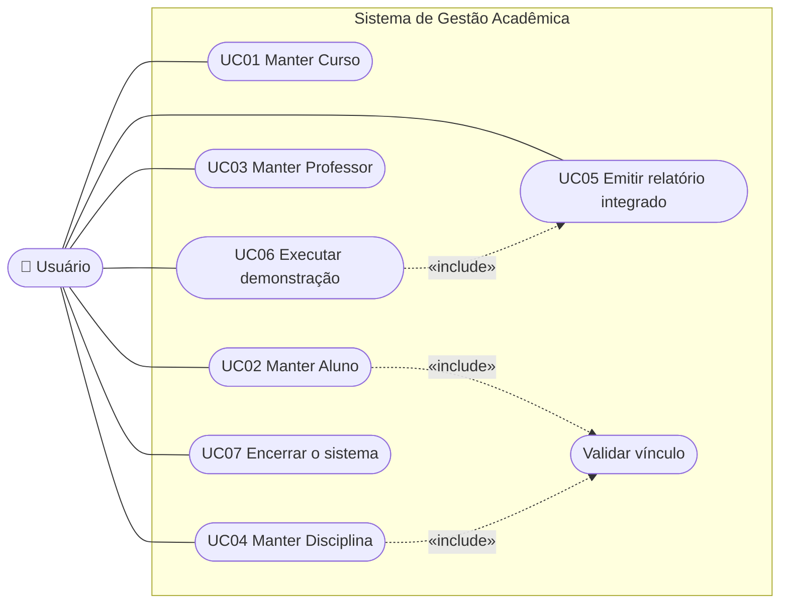

# Especificação de Requisitos

> Estrutura inspirada na IEEE 830 / ISO/IEC/IEEE 29148, de forma simplificada.
> Fontes: o enunciado "Projeto Prático — Sistema de Gestão Acadêmica Integrado" (PDF) e
> as listas de requisitos RF01–RF18 e RF19–RF24 (Módulo de Avaliação Acadêmica) entregues depois.

## 1. Escopo

O sistema permite cadastrar, consultar, alterar e excluir Cursos, Alunos, Professores e
Disciplinas, manter os vínculos entre eles e emitir um relatório consolidado. O Módulo de
Avaliação Acadêmica registra três notas com pesos por aluno e disciplina, calcula a média
ponderada e emite o relatório de rendimento escolar (aprovado/reprovado). Os dados
ficam em arquivos `.txt` locais. Um único usuário usa o sistema por vez, sem autenticação.

## 2. Atores

| Ator | Descrição |
|------|-----------|
| Usuário | Opera o sistema pela GUI ou pelo console |
| Sistema de arquivos | Guarda os quatro `.txt` (ator secundário) |

## 3. Casos de uso

"Manter" engloba cadastrar, listar, pesquisar, alterar e excluir (CRUD).

### UC02 — Manter Aluno (exemplo detalhado; os demais seguem o mesmo fluxo)

| Item | Descrição |
|------|-----------|
| Pré-condição | O curso do aluno já existe |
| Fluxo principal (cadastro) | 1. O usuário escolhe Alunos → Cadastrar. 2. Informa matrícula, nome, CPF, e-mail e código do curso. 3. O sistema valida os campos. 4. O sistema verifica se a matrícula e o CPF são únicos e se o curso existe. 5. O sistema grava em `alunos.txt` e confirma. |
| Fluxo alternativo 3a | Um campo é inválido: o sistema mostra a regra violada e nada é gravado |
| Fluxo alternativo 4a | O curso não existe: "O curso 'X' não existe. Cadastre o curso primeiro." |
| Fluxo alternativo 4b | A matrícula ou o CPF já existe: mensagem de duplicidade |
| Fluxo alternativo 5a | Falha de disco: mensagem de erro; a memória permanece como antes |
| Pós-condição | O aluno aparece na listagem e no relatório |

## 4. Requisitos funcionais

Critérios de aceitação no formato **Dado / Quando / Então**.

| ID | Requisito | Critério de aceitação |
|----|-----------|----------------------|
| RF01 | Cadastrar entidades | **Dado** dados válidos, **quando** o usuário cadastra, **então** o registro aparece na listagem e numa nova linha do `.txt` |
| RF02 | Listar entidades | **Quando** o usuário lista, **então** todos os registros carregados são exibidos formatados (tabela no console e na GUI) |
| RF03 | Pesquisar por código ou nome | **Quando** o usuário busca "202301" ou "joao", **então** encontra João Silva (código exato; nome por trecho, sem diferenciar acentos e maiúsculas) |
| RF04 | Alterar qualquer atributo | **Dado** um registro existente, **quando** um ou mais atributos são alterados (inclusive o código), **então** o `.txt` reflete a mudança e os vínculos são atualizados (RN05) |
| RF05 | Excluir pelo identificador | **Dado** um código sem dependentes, **quando** o usuário confirma a exclusão, **então** a linha some do `.txt` |
| RF06 | Aluno: matrícula, nome, CPF, e-mail, código do curso | A ausência de qualquer campo impede o cadastro |
| RF07 | Curso: código, nome, modalidade (Presencial/EAD) | Uma modalidade diferente de Presencial/EAD é recusada |
| RF08 | Professor: código, nome, CPF, especialidade | A ausência de qualquer campo impede o cadastro |
| RF09 | Disciplina: código, nome, carga horária, código do professor, código do curso | Uma carga horária não inteira ou ≤ 0 é recusada |
| RF10 | Persistência em `.txt` com `;` | Os arquivos têm exatamente os nomes exigidos e cada linha usa `;` |
| RF11 | Carregamento inicial | **Quando** o sistema inicia, **então** todos os registros válidos dos `.txt` estão disponíveis em memória |
| RF12 | Sincronização de escrita | **Após** cadastrar, alterar ou excluir, **então** uma nova execução enxerga a mudança |
| RF13 | Vincular Aluno a Curso | Não é possível cadastrar ou alterar um aluno para um curso inexistente |
| RF14 | Vincular Disciplina a Professor e Curso | Não é possível cadastrar ou alterar uma disciplina com professor ou curso inexistente |
| RF15 | Relatório integrado | Para cada aluno e cada disciplina do seu curso: "O Aluno [Nome] está matriculado no curso [Nome do Curso], assistindo a disciplina [Nome da Disciplina] com o professor [Nome do Professor]" |
| RF16 | Ponto de entrada único `main.py` | Todas as funcionalidades das duas equipes são acessíveis a partir de `python main.py` |
| RF17 | Menu de navegação | Existe um menu (console e GUI) para escolher a operação |
| RF18 | Encerramento controlado | A saída pede confirmação, informa que os dados estão gravados e encerra com código 0, inclusive com Ctrl+C ou Ctrl+D |
| RF19 | `Nota`, `GerenciadorNotas.validar_vinculos` | `test_rf19_*` |
| RF20 | `Gerenciador._para_linha` / `_de_linha` (com `Nota.CAMPOS`) | `test_rf20_*` |
| RF21 | `avaliacao.calculo.media_ponderada` | `test_rf21_*` |
| RF22 | `avaliacao.validacoes`, `media_ponderada` (teto) | `test_rf22_*` |
| RF23 | `GerenciadorRendimento`, `status`, `main.py --rendimento`, menu e GUI | `test_rf23_*` |
| RF24 | `GerenciadorNotas.listar` (relê o arquivo), `alterar` | `test_rf24_*` |
| RF-PDF-5 | Integração Final | O `main.py` consegue, em sequência: cadastrar Professor e Curso → Disciplina vinculada → Aluno vinculado → relatório |

| RF19 | Estrutura de armazenamento de notas | Cada registro tem matrícula (de `alunos.txt`), código da disciplina (de `disciplinas.txt`), nota 1/peso 1, nota 2/peso 2 e nota 3/peso 3. Aluno ou disciplina inexistente impede o lançamento |
| RF20 | Persistência em `notas.txt` | Cada linha segue `matricula;codigo_disciplina;nota1;peso1;nota2;peso2;nota3;peso3`, ex.: `202301;D01;8.5;2;7.0;3;9.0;5` |
| RF21 | Média ponderada | **Dado** um registro, **quando** as notas são listadas ou o relatório é gerado, **então** a média é `(N1×P1 + N2×P2 + N3×P3) / (P1 + P2 + P3)`, calculada na hora (não é gravada) |
| RF22 | Validação e teto de pontuação | Nota fora de 0.0–10.0 é recusada; a média nunca passa de 10.0 (recusa na entrada **e** limitação a 10.00 no cálculo) |
| RF23 | Relatório de rendimento escolar | Para cada registro: nome do aluno, nome da disciplina, notas e pesos, média final e status (`Aprovado` se média ≥ 7.0, `Reprovado` se < 7.0) |
| RF24 | Alteração e recálculo | **Quando** uma nota ou peso muda (pelo sistema ou editando o `notas.txt`), **então** a média exibida na leitura seguinte já usa os novos valores |

## 5. Regras de negócio

| ID | Regra | Implementação |
|----|-------|---------------|
| RN01 | O identificador (primeiro campo) é único em cada entidade | `Gerenciador.cadastrar` / `alterar` |
| RN02 | O CPF é único entre alunos e, separadamente, entre professores | `CAMPOS_UNICOS = ("cpf",)` |
| RN03 | O CPF é guardado sempre como `000.000.000-00` | `validar_cpf` |
| RN04 | Um curso só pode ser excluído sem alunos e sem disciplinas; um professor, sem disciplinas | `Gerenciador.excluir` + `dependentes` |
| RN05 | Trocar o código de um curso ou professor atualiza os registros que o referenciam | `Gerenciador.alterar` + `_trocas_de_referencia` |
| RN06 | A modalidade é gravada como `Presencial` ou `EAD`, aceitando qualquer caixa na entrada | `validar_modalidade` |
| RN07 | Nenhum campo pode ser vazio, conter `;` ou caracteres de controle | `propriedade()` |
| RN08 | Um aluno de curso sem disciplinas aparece no relatório como "sem disciplinas cadastradas" | `LinhaRelatorio.frase` |
| RN09 | Um aluno tem no máximo um registro de notas por disciplina (chave composta matrícula + disciplina) | `GerenciadorNotas.identificador` |
| RN10 | Aluno ou disciplina com notas não pode ser excluído; trocar a matrícula ou o código da disciplina atualiza o `notas.txt` | `dependentes` registrados no `SistemaIntegrado` |
| RN11 | Notas e pesos são `Decimal`; a vírgula decimal é aceita na entrada e gravada como ponto; pesos ≥ 0 e soma dos pesos > 0 | `avaliacao/validacoes.py`, `Nota.__init__` |
| RN12 | A média é arredondada a 2 casas (meio para cima) e o status usa a média arredondada, a que o usuário vê | `avaliacao/calculo.py` |

## 6. Requisitos não funcionais

| ID | Categoria (ISO 25010) | Requisito |
|----|----------------------|-----------|
| RNF01 | Portabilidade | Executar em Python 3.10+ só com a biblioteca padrão, em Windows, Linux e macOS |
| RNF02 | Portabilidade | Sem Tkinter ou sem tela, abrir o console automaticamente |
| RNF03 | Confiabilidade | Uma falha durante a gravação não deixa um `.txt` pela metade nem a memória divergente do disco |
| RNF04 | Confiabilidade | Linhas corrompidas não impedem a abertura do sistema |
| RNF05 | Segurança | Recusar entradas que corrompam o formato do arquivo ou manipulem o terminal |
| RNF06 | Manutenibilidade | Entidades apenas como modelos de dados; regras nas gerenciadoras; 100% das funções documentadas |
| RNF07 | Usabilidade | Mensagens de erro em português, dizendo o que corrigir |
| RNF08 | Desempenho | Relatório em tempo linear no número de registros |

## 7. Requisitos técnicos do enunciado (Seção 4)

| Item | Atendimento |
|------|-------------|
| Classes de entidade com `__init__` e `__str__` | `Aluno`, `Curso`, `Professor`, `Disciplina` |
| Encapsulamento: atributos protegidos + `@property` | `propriedade()` cria `_atributo` + property |
| Classes gerenciadoras com a lógica de arquivos e listas | `Gerenciador*` (ver ADR-002) |
| Acordo de IDs entre equipes (`codigo_curso`) | ADR-004 |

## 8. Matriz de rastreabilidade

Requisito → código → teste automatizado (`testes/`).

| Req. | Código | Teste(s) |
|------|--------|----------|
| RF01 | `Gerenciador.cadastrar` | `test_rf01_cadastrar_grava_no_txt`, `test_codigo_duplicado_e_rejeitado`, `test_rf17_cadastro_completo_pelo_menu` |
| RF02 | `Gerenciador.listar` | `test_rf02_listar_converte_em_objetos` |
| RF03 | `Gerenciador.pesquisar` | `test_rf03_pesquisar_por_codigo_e_por_nome` |
| RF04 | `Gerenciador.alterar`, `_trocas_de_referencia`, `_desfazer` | `test_rf04_alterar_reflete_no_arquivo`, `test_rf04_alterar_o_codigo_atualiza_vinculos_em_cascata`, `test_rf04_alterar_codigo_do_professor_atualiza_disciplinas`, `test_rf04_codigo_novo_ja_existente_e_rejeitado_sem_alterar_nada`, `test_rf04_falha_de_disco_na_cascata_desfaz_tudo`, `test_rf04_alterar_codigo_pelo_menu_console`, `test_rf17_alterar_mantendo_campos_com_enter` |
| RF05 | `Gerenciador.excluir` | `test_rf05_excluir_remove_do_arquivo`, `test_exclusao_bloqueada_quando_ha_dependentes` |
| RF06–RF09 | `alfa/*.py`, `beta/*.py`, `validar_*` | `test_rf06_a_rf09_campos_obrigatorios`, `test_rf07_modalidade_apenas_presencial_ou_ead`, `test_campo_vazio_ou_com_separador_e_rejeitado` |
| RF10 | `SEPARADOR`, `_para_linha`, `_de_linha` | `test_rf10_separador_ponto_e_virgula`, `test_gerenciador_converte_objeto_e_linha_nos_dois_sentidos` |
| RF11 | `Gerenciador.carregar` | `test_rf11_carregamento_inicial` |
| RF12 | `Gerenciador.salvar` | `test_rf12_escrita_persiste_entre_execucoes` |
| RF13 | `GerenciadorAlunos.validar_vinculos` | `test_rf13_aluno_exige_curso_existente` |
| RF14 | `GerenciadorDisciplinas.validar_vinculos` | `test_rf14_disciplina_exige_professor_e_curso` |
| RF15 | `GerenciadorRelatorios` | `test_rf15_frase_do_relatorio`, `test_rf15_uma_linha_por_disciplina_do_curso`, `test_rf17_relatorio_pelo_menu` |
| RF16 | `main.py` | `test_rf16_main_gera_relatorio`, `test_rf16_main_roda_demonstracao` |
| RF17 | `MenuConsole`, `AplicacaoAcademica` | `test_rf17_*`, `test_opcao_invalida_nao_quebra_o_menu` (GUI: teste manual, ver estratégia de testes) |
| RF18 | `MenuConsole.sair`, `AplicacaoAcademica.encerrar` | `test_rf18_sair_com_confirmacao`, `test_rf18_ctrl_d_encerra_sem_erro` |
| RF-PDF-5 | `demonstracao.py` | `test_demonstracao_cadastra_na_ordem_e_persiste`, `test_demonstracao_pode_rodar_duas_vezes_sem_duplicar`, `test_demonstracao_pelo_menu_console` |
| 4.A | entidades + `propriedade()` | `test_entidades_tem_init_e_str_proprios`, `test_encapsulamento_com_property_e_atributo_protegido` |
| RNF05 | `propriedade()` | `test_caracteres_de_controle_sao_bloqueados` |
| RNF06 | toda a base | `test_entidades_so_definem_init_e_str`, `test_entidades_nao_acessam_arquivos`, `test_cobertura_de_docstrings_e_total`, `test_camadas_respeitam_as_dependencias_permitidas`, `test_beta_e_independente_da_alfa` |

## 9. Divergências e interpretações registradas

| Ponto | Interpretação adotada |
|-------|----------------------|
| O exemplo do PDF `202301;João Silva;123.456.789-00;10` não tem e-mail | Seguimos o RF06 e o Módulo Aluno: o arquivo tem 5 colunas, com e-mail |
| RF04 "qualquer um de seus atributos" | Inclui o código, com cascata (ADR-006) |
| RF17 "console ou interface gráfica" | Ambos foram entregues; a GUI é o padrão e o console é o fallback |
| RF22 "limitar o resultado ao teto de 10.0" ou "retornar erro" | Os dois: a entrada fora de 0–10 é recusada e a média é limitada a 10.00. Com notas válidas, uma média ponderada nunca passa de 10 qualquer que seja a soma dos pesos |
| RF19 "vinculada a alunos.txt / disciplinas.txt" | Exige que o aluno e a disciplina existam; **não** exige que a disciplina seja do curso do aluno (não pedido) |
| RF20 exemplo `202301;MAT101;...` | O formato é o pedido; no `dados/notas.txt` de exemplo foram usados códigos que existem nos demais arquivos (`D01`, `D02`) |
| RF23 "Média ≥ 7.0" | Compara a média já arredondada a 2 casas (a que aparece na tela) |
| RF03 "pelo Nome" | Busca por trecho do nome, sem diferenciar acentos e maiúsculas |
